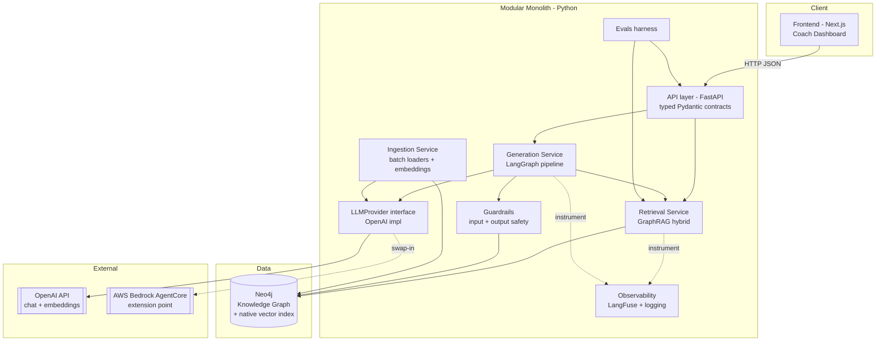
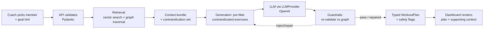
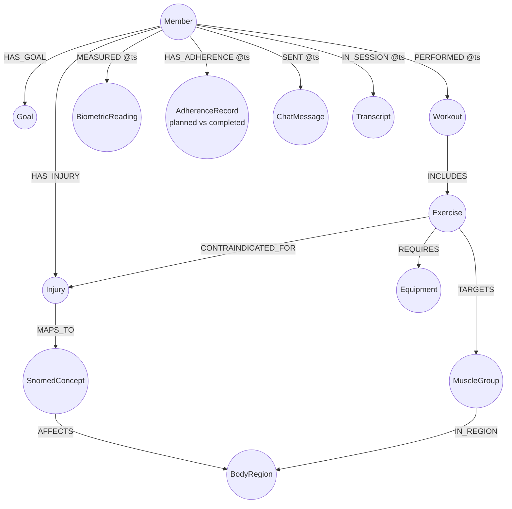
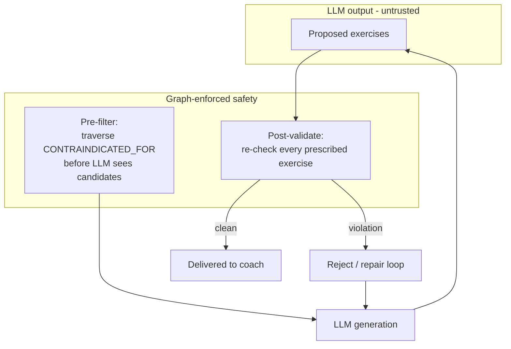

# Architecture Diagram — Knowledge Graph Coaching Platform

## Component / interaction diagram

## Data flow — generate a safe workout

## Knowledge graph schema (core entities & relationships)

## Safety enforcement (trust boundary)

